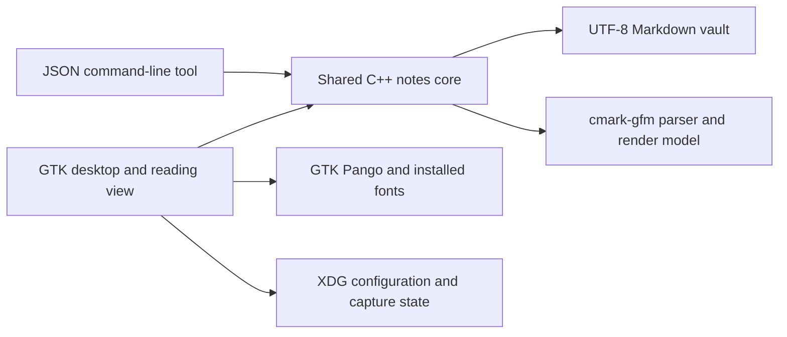

# LCOS Notes architecture

This describes LCOS Notes 1.0.0, built from the accepted U10 and 1.0-polish
implementation. Release changes are version metadata and documentation; the
accepted rendering, vault and capture behavior is retained.

## Components

| Source | Responsibility |
|---|---|
| `src/core.hpp`, `src/core.cpp` | Vault traversal, note/link resolution, safe writes, renames, tags, search and shared document model |
| `src/render.cpp` | cmark-gfm rendering; text, Unicode codepoint ranges, links, tasks, embeds, callouts and highlight spans |
| `src/u9.cpp` | Daily notes, templates, timestamp names and capture |
| `src/u10.cpp` | Supported properties/aliases, headings and supersession |
| `src/gui.cpp` | GTKmm editor, menus, sidebars, dialogs, file monitoring and native reading presentation |
| `src/cli.cpp` | JSON operations over the same core; success0/refusal2 |
| `meson.build` | C++17 shared static core and two installed executables |
| `packaging/build-deb.sh`, `data/` | Debian package construction, desktop metadata, icon and offline manual pages |

The desktop uses GTKmm3, GtkSourceViewmm3, GLib and cmark-gfm. The GUI and CLI link
the same core. Markdown is the persistent record; there is no cloud service,
account, telemetry, embedding model or semantic database in this application.

## Data and write boundaries

Visible lowercase `.md` files inside the chosen folder are notes. Hidden entries
and symlinks are excluded from note operations. Supported Obsidian daily-note,
template and timestamp configuration is read explicitly; hidden directories,
including `.obsidian/` and `.sqlite-mem/`, are never written by Notes.

Note saves preserve existing source bytes outside the intended edit, including
line endings and final-newline behavior. Saves use a temporary file beside the
destination followed by rename; an unchanged note is not rewritten. The app
refuses a stale save when disk content changed, preserving the pending buffer.
An explicit Reload discards that buffer. This is a conflict safeguard, not a
backup/version-control system or a general multi-process transaction protocol.

Move/Archive reuse relocation and link-repair rules. Collision and path validation
precede writes; supported resolved references retain their target identity.
Supersede changes two documents: each save is atomic, but the two saves are not one
transaction, so a second-save failure can leave the first change in place.

Last-vault configuration and capture-target state live under standard XDG
locations outside the vault. The notes themselves remain ordinary UTF-8 files.

## Rendering and paragraph ownership

The shared renderer produces visible text and style/link/task/block ranges.
Ranges use Unicode codepoint offsets, with exclusive ends; file positions and
rendered positions are distinct. GTK applies native text tags in reading view.

Highlights scan visible inline content across emphasis/strong/link containers.
Inline code may retain its style inside a surrounding highlight, but cannot
supply delimiters. Source line breaks, raw HTML and block boundaries stop a match.

For a full-width callout, GTK paragraph background must include the paragraph's
beginning, including generated list prefixes. The accepted GUI rounds only the
background-paint start to that paragraph boundary. It does not rewrite parser
structure, visible text, semantic link offsets or folding coordinates. Nested
kinds retain innermost color priority and ordinary neighboring paragraphs remain
untinted. Representative nested/mixed-list native regressions preserve this rule.

Pango/Fontconfig select glyphs from installed fonts. Optional CJK coverage is an OS
font choice: `fonts-noto-cjk`; it is not a new mandatory app dependency. A missing
glyph box alone does not demonstrate a text-offset or Markdown parsing defect.

## Verification and limits

Engineering acceptance is 838 passing tests, including native GUI regression
cases. The final Devuan-built package passed 59 installed LCOS regression/polish
checks and qualified independent engineering review. Five desktop product checks
passed; the final CJK check used the unchanged binary after a per-user font install.
These are evidence for this candidate, not universal input/platform guarantees.

Retained limits: folded callouts can show an extra tinted blank row; extreme
unmatched-highlight input can be slow; mouse-only Screen Sharing operation remains
unverified. Scope does not include U11/U12, semantic recall M5 or the parked native
Mac product. See [release notes](RELEASE-NOTES.md), [user guide](DOCUMENTATION.md)
and [retained scope](RELEASE-NOTES.md#documented-limitations). Earlier rejected attempts remain in the private audit
record; this acceptance does not rewrite their outcomes.
